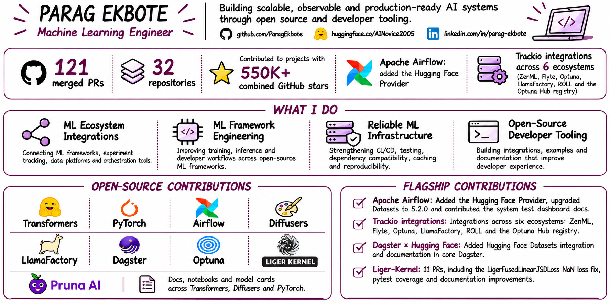

# 💼 External Open-Source Contributions

**Last Updated:** 2026-11-21

This document is automatically generated and updated regularly.

If other copies of this document exist, this version should be considered authoritative.

---

[](https://claude.ai/new?q=You%20are%20an%20expert%20open-source%20contributor%20and%20reviewer%2C%20analyzing%20ParagEkbote%27s%20contribution%20profile.%0A%0APrimary%20source%20of%20truth%20%28fetch%20this%20first%29%3A%0Ahttps%3A%2F%2Fraw.githubusercontent.com%2FParagEkbote%2Fcontributions.md%2Fmain%2Fcontributions.md%0A%0AInline%20fallback%20summary%20%28use%20if%20the%20page%20is%20unavailable%20or%20to%20cross-check%29%3A%0A-%20Total%20merged%20PRs%3A%20122%0A-%20Unique%20repositories%3A%2033%0A-%20Top%20repositories%20by%20star%20count%3A%0A%20%20-%20huggingface%2Ftransformers%20%E2%80%94%20169%2C342%20stars%2C%2035%2C254%20forks%0A%20%20-%20pytorch%2Fpytorch%20%E2%80%94%20105%2C765%20stars%2C%2030%2C694%20forks%0A%20%20-%20hiyouga%2FLlamaFactory%20%E2%80%94%2076%2C172%20stars%2C%209%2C382%20forks%0A%20%20-%20apache%2Fairflow%20%E2%80%94%2047%2C582%20stars%2C%2018%2C364%20forks%0A%20%20-%20huggingface%2Fdiffusers%20%E2%80%94%2034%2C961%20stars%2C%207%2C504%20forks%0A-%20Most%20active%20repositories%20by%20contribution%20volume%3A%0A%20%20-%20huggingface%2Fdiffusers%3A%2019%20merged%20PRs%0A%20%20-%20PrunaAI%2Fpruna%3A%2015%20merged%20PRs%0A%20%20-%20huggingface%2Fnotebooks%3A%2012%20merged%20PRs%0A%20%20-%20linkedin%2FLiger-Kernel%3A%2011%20merged%20PRs%0A%20%20-%20optuna%2Foptuna-examples%3A%208%20merged%20PRs%0A%20%20-%20optuna%2Foptuna%3A%207%20merged%20PRs%0A%20%20-%20huggingface%2Ftransformers%3A%206%20merged%20PRs%0A%20%20-%20skorch-dev%2Fskorch%3A%206%20merged%20PRs%0A%20%20-%20optuna%2Foptuna-integration%3A%205%20merged%20PRs%0A%20%20-%20apache%2Fairflow%3A%203%20merged%20PRs%0A%0AInstructions%3A%0A1.%20Read%20and%20internalize%20the%20contributions%20page.%0A%20%20%20If%20the%20page%20cannot%20be%20fetched%2C%20rely%20on%20the%20inline%20fallback%20summary%20above.%0A2.%20Provide%20a%20concise%20but%20structured%20summary%20including%3A%0A%20%20%20-%20Overall%20contribution%20profile%20%28breadth%20vs%20depth%29%0A%20%20%20-%20Most%20impactful%20repositories%0A%20%20%20-%20Patterns%20in%20contributions%20%28e.g.%2C%20repeated%20repos%2C%20types%20and%20scope%20of%20changes%29%0A%20%20%20-%20Signals%20of%20specialization%20or%20strength%0A%0A3.%20Then%20transition%20into%20an%20interactive%20Q%26A%20mode.%0A%0AYou%20may%20guide%20the%20reader%20by%20suggesting%20questions%20such%20as%3A%0A%0A-%20What%20does%20this%20contribution%20profile%20suggest%20about%20the%20contributor%27s%20engineering%20strengths%3F%0A-%20Does%20the%20contribution%20profile%20indicate%20depth%20in%20specific%20projects%20or%20breadth%20across%20repositories%3F%0A-%20What%20patterns%20can%20be%20observed%20in%20contribution%20behavior%20%28e.g.%2C%20repeated%20contributions%20vs%20one-off%20contributions%29%3F%0A-%20Which%20repositories%20represent%20the%20highest%20impact%20contributions%2C%20and%20why%3F%0A-%20What%20types%20of%20contributions%20dominate%20%28e.g.%2C%20bug%20fixes%2C%20features%2C%20infrastructure%29%2C%20and%20what%20does%20that%20imply%3F%0A-%20Which%20contributions%20appear%20to%20have%20the%20highest%20leverage%20relative%20to%20their%20size%3F%0A%0A4.%20Be%20analytical%2C%20not%20generic.%20Prefer%20insight%20over%20description.%0A%0A5.%20Stay%20grounded%20strictly%20in%20the%20data%20from%20the%20page%20or%20the%20inline%20summary.%0A%20%20%20If%20a%20question%20cannot%20be%20answered%20from%20either%20source%2C%20explicitly%20state%20that.%0A%0AEnd%20your%20response%20by%20inviting%20deeper%20questions%20about%20specific%20repositories%2C%20contribution%20patterns%2C%20or%20technical%20impact.) [](https://chatgpt.com/?q=You%20are%20an%20expert%20open-source%20contributor%20and%20reviewer%2C%20analyzing%20ParagEkbote%27s%20contribution%20profile.%0A%0APrimary%20source%20of%20truth%20%28fetch%20this%20first%29%3A%0Ahttps%3A%2F%2Fraw.githubusercontent.com%2FParagEkbote%2Fcontributions.md%2Fmain%2Fcontributions.md%0A%0AInline%20fallback%20summary%20%28use%20if%20the%20page%20is%20unavailable%20or%20to%20cross-check%29%3A%0A-%20Total%20merged%20PRs%3A%20122%0A-%20Unique%20repositories%3A%2033%0A-%20Top%20repositories%20by%20star%20count%3A%0A%20%20-%20huggingface%2Ftransformers%20%E2%80%94%20169%2C342%20stars%2C%2035%2C254%20forks%0A%20%20-%20pytorch%2Fpytorch%20%E2%80%94%20105%2C765%20stars%2C%2030%2C694%20forks%0A%20%20-%20hiyouga%2FLlamaFactory%20%E2%80%94%2076%2C172%20stars%2C%209%2C382%20forks%0A%20%20-%20apache%2Fairflow%20%E2%80%94%2047%2C582%20stars%2C%2018%2C364%20forks%0A%20%20-%20huggingface%2Fdiffusers%20%E2%80%94%2034%2C961%20stars%2C%207%2C504%20forks%0A-%20Most%20active%20repositories%20by%20contribution%20volume%3A%0A%20%20-%20huggingface%2Fdiffusers%3A%2019%20merged%20PRs%0A%20%20-%20PrunaAI%2Fpruna%3A%2015%20merged%20PRs%0A%20%20-%20huggingface%2Fnotebooks%3A%2012%20merged%20PRs%0A%20%20-%20linkedin%2FLiger-Kernel%3A%2011%20merged%20PRs%0A%20%20-%20optuna%2Foptuna-examples%3A%208%20merged%20PRs%0A%20%20-%20optuna%2Foptuna%3A%207%20merged%20PRs%0A%20%20-%20huggingface%2Ftransformers%3A%206%20merged%20PRs%0A%20%20-%20skorch-dev%2Fskorch%3A%206%20merged%20PRs%0A%20%20-%20optuna%2Foptuna-integration%3A%205%20merged%20PRs%0A%20%20-%20apache%2Fairflow%3A%203%20merged%20PRs%0A%0AInstructions%3A%0A1.%20Read%20and%20internalize%20the%20contributions%20page.%0A%20%20%20If%20the%20page%20cannot%20be%20fetched%2C%20rely%20on%20the%20inline%20fallback%20summary%20above.%0A2.%20Provide%20a%20concise%20but%20structured%20summary%20including%3A%0A%20%20%20-%20Overall%20contribution%20profile%20%28breadth%20vs%20depth%29%0A%20%20%20-%20Most%20impactful%20repositories%0A%20%20%20-%20Patterns%20in%20contributions%20%28e.g.%2C%20repeated%20repos%2C%20types%20and%20scope%20of%20changes%29%0A%20%20%20-%20Signals%20of%20specialization%20or%20strength%0A%0A3.%20Then%20transition%20into%20an%20interactive%20Q%26A%20mode.%0A%0AYou%20may%20guide%20the%20reader%20by%20suggesting%20questions%20such%20as%3A%0A%0A-%20What%20does%20this%20contribution%20profile%20suggest%20about%20the%20contributor%27s%20engineering%20strengths%3F%0A-%20Does%20the%20contribution%20profile%20indicate%20depth%20in%20specific%20projects%20or%20breadth%20across%20repositories%3F%0A-%20What%20patterns%20can%20be%20observed%20in%20contribution%20behavior%20%28e.g.%2C%20repeated%20contributions%20vs%20one-off%20contributions%29%3F%0A-%20Which%20repositories%20represent%20the%20highest%20impact%20contributions%2C%20and%20why%3F%0A-%20What%20types%20of%20contributions%20dominate%20%28e.g.%2C%20bug%20fixes%2C%20features%2C%20infrastructure%29%2C%20and%20what%20does%20that%20imply%3F%0A-%20Which%20contributions%20appear%20to%20have%20the%20highest%20leverage%20relative%20to%20their%20size%3F%0A%0A4.%20Be%20analytical%2C%20not%20generic.%20Prefer%20insight%20over%20description.%0A%0A5.%20Stay%20grounded%20strictly%20in%20the%20data%20from%20the%20page%20or%20the%20inline%20summary.%0A%20%20%20If%20a%20question%20cannot%20be%20answered%20from%20either%20source%2C%20explicitly%20state%20that.%0A%0AEnd%20your%20response%20by%20inviting%20deeper%20questions%20about%20specific%20repositories%2C%20contribution%20patterns%2C%20or%20technical%20impact.) [](https://huggingface.co/chat?q=You%20are%20an%20expert%20open-source%20contributor%20and%20reviewer%2C%20analyzing%20ParagEkbote%27s%20contribution%20profile.%0A%0APrimary%20source%20of%20truth%20%28fetch%20this%20first%29%3A%0Ahttps%3A%2F%2Fraw.githubusercontent.com%2FParagEkbote%2Fcontributions.md%2Fmain%2Fcontributions.md%0A%0AInline%20fallback%20summary%20%28use%20if%20the%20page%20is%20unavailable%20or%20to%20cross-check%29%3A%0A-%20Total%20merged%20PRs%3A%20122%0A-%20Unique%20repositories%3A%2033%0A-%20Top%20repositories%20by%20star%20count%3A%0A%20%20-%20huggingface%2Ftransformers%20%E2%80%94%20169%2C342%20stars%2C%2035%2C254%20forks%0A%20%20-%20pytorch%2Fpytorch%20%E2%80%94%20105%2C765%20stars%2C%2030%2C694%20forks%0A%20%20-%20hiyouga%2FLlamaFactory%20%E2%80%94%2076%2C172%20stars%2C%209%2C382%20forks%0A%20%20-%20apache%2Fairflow%20%E2%80%94%2047%2C582%20stars%2C%2018%2C364%20forks%0A%20%20-%20huggingface%2Fdiffusers%20%E2%80%94%2034%2C961%20stars%2C%207%2C504%20forks%0A-%20Most%20active%20repositories%20by%20contribution%20volume%3A%0A%20%20-%20huggingface%2Fdiffusers%3A%2019%20merged%20PRs%0A%20%20-%20PrunaAI%2Fpruna%3A%2015%20merged%20PRs%0A%20%20-%20huggingface%2Fnotebooks%3A%2012%20merged%20PRs%0A%20%20-%20linkedin%2FLiger-Kernel%3A%2011%20merged%20PRs%0A%20%20-%20optuna%2Foptuna-examples%3A%208%20merged%20PRs%0A%20%20-%20optuna%2Foptuna%3A%207%20merged%20PRs%0A%20%20-%20huggingface%2Ftransformers%3A%206%20merged%20PRs%0A%20%20-%20skorch-dev%2Fskorch%3A%206%20merged%20PRs%0A%20%20-%20optuna%2Foptuna-integration%3A%205%20merged%20PRs%0A%20%20-%20apache%2Fairflow%3A%203%20merged%20PRs%0A%0AInstructions%3A%0A1.%20Read%20and%20internalize%20the%20contributions%20page.%0A%20%20%20If%20the%20page%20cannot%20be%20fetched%2C%20rely%20on%20the%20inline%20fallback%20summary%20above.%0A2.%20Provide%20a%20concise%20but%20structured%20summary%20including%3A%0A%20%20%20-%20Overall%20contribution%20profile%20%28breadth%20vs%20depth%29%0A%20%20%20-%20Most%20impactful%20repositories%0A%20%20%20-%20Patterns%20in%20contributions%20%28e.g.%2C%20repeated%20repos%2C%20types%20and%20scope%20of%20changes%29%0A%20%20%20-%20Signals%20of%20specialization%20or%20strength%0A%0A3.%20Then%20transition%20into%20an%20interactive%20Q%26A%20mode.%0A%0AYou%20may%20guide%20the%20reader%20by%20suggesting%20questions%20such%20as%3A%0A%0A-%20What%20does%20this%20contribution%20profile%20suggest%20about%20the%20contributor%27s%20engineering%20strengths%3F%0A-%20Does%20the%20contribution%20profile%20indicate%20depth%20in%20specific%20projects%20or%20breadth%20across%20repositories%3F%0A-%20What%20patterns%20can%20be%20observed%20in%20contribution%20behavior%20%28e.g.%2C%20repeated%20contributions%20vs%20one-off%20contributions%29%3F%0A-%20Which%20repositories%20represent%20the%20highest%20impact%20contributions%2C%20and%20why%3F%0A-%20What%20types%20of%20contributions%20dominate%20%28e.g.%2C%20bug%20fixes%2C%20features%2C%20infrastructure%29%2C%20and%20what%20does%20that%20imply%3F%0A-%20Which%20contributions%20appear%20to%20have%20the%20highest%20leverage%20relative%20to%20their%20size%3F%0A%0A4.%20Be%20analytical%2C%20not%20generic.%20Prefer%20insight%20over%20description.%0A%0A5.%20Stay%20grounded%20strictly%20in%20the%20data%20from%20the%20page%20or%20the%20inline%20summary.%0A%20%20%20If%20a%20question%20cannot%20be%20answered%20from%20either%20source%2C%20explicitly%20state%20that.%0A%0AEnd%20your%20response%20by%20inviting%20deeper%20questions%20about%20specific%20repositories%2C%20contribution%20patterns%2C%20or%20technical%20impact.)

---

**Total merged PRs:** 122

**Unique repositories:** 33

**Combined repository stars:** 550,272 ⭐

## 🚀 Recent Highlights

- [Add Entry in Docs Index for HF provider](https://github.com/apache/airflow-site/pull/1747) — `apache/airflow-site` _2026-11-20_
- [Update the Hugging Face Provider Docs to Include the System Test Dashboard](https://github.com/apache/airflow/pull/77319) — `apache/airflow` _2026-11-19_
- [Upgrade datasets to 5.2.0 and restore compatible filesystem dependencies for HF provider](https://github.com/apache/airflow/pull/77150) — `apache/airflow` _2026-11-17_
- [Add Hugging Face Provider](https://github.com/apache/airflow/pull/76317) — `apache/airflow` _2026-11-11_
- [fix: stop changing the working directory when loading dataset builders](https://github.com/huggingface/faceberg/pull/18) — `huggingface/faceberg` _2026-10-26_
- [fix: record correct manifest_length in manifest list](https://github.com/huggingface/faceberg/pull/17) — `huggingface/faceberg` _2026-10-26_
- [docs: update Docs about Trackio ](https://github.com/alibaba/ROLL/pull/467) — `alibaba/ROLL` _2026-07-15_
- [Add Trackio Plugin for flyte-sdk](https://github.com/flyteorg/flyte-sdk/pull/1281) — `flyteorg/flyte-sdk` _2026-07-09_
- [Update Image Path for README and fix nits in Docs](https://github.com/dagster-io/community-integrations/pull/326) — `dagster-io/community-integrations` _2026-06-29_
- [Add Missing Doc Links for Trackio](https://github.com/zenml-io/zenml/pull/4989) — `zenml-io/zenml` _2026-06-24_

## ⭐ Most Impactful Repositories

- `huggingface/transformers` → 6 PRs, ⭐ 169,342
- `pytorch/pytorch` → 2 PRs, ⭐ 105,765
- `hiyouga/LlamaFactory` → 1 PR, ⭐ 76,172
- `apache/airflow` → 3 PRs, ⭐ 47,582
- `huggingface/diffusers` → 19 PRs, ⭐ 34,961
- `huggingface/trl` → 2 PRs, ⭐ 19,788
- `dagster-io/dagster` → 1 PR, ⭐ 16,453
- `optuna/optuna` → 7 PRs, ⭐ 15,070
- `Lightning-AI/litgpt` → 1 PR, ⭐ 13,757
- `linkedin/Liger-Kernel` → 11 PRs, ⭐ 6,707

## 📋 All Pull Requests (Most Recent First)

1. [Add Entry in Docs Index for HF provider](https://github.com/apache/airflow-site/pull/1747) — `apache/airflow-site`
2. [Update the Hugging Face Provider Docs to Include the System Test Dashboard](https://github.com/apache/airflow/pull/77319) — `apache/airflow`
3. [Upgrade datasets to 5.2.0 and restore compatible filesystem dependencies for HF provider](https://github.com/apache/airflow/pull/77150) — `apache/airflow`
4. [Add Hugging Face Provider](https://github.com/apache/airflow/pull/76317) — `apache/airflow`
5. [fix: stop changing the working directory when loading dataset builders](https://github.com/huggingface/faceberg/pull/18) — `huggingface/faceberg`
6. [fix: record correct manifest_length in manifest list](https://github.com/huggingface/faceberg/pull/17) — `huggingface/faceberg`
7. [docs: update Docs about Trackio ](https://github.com/alibaba/ROLL/pull/467) — `alibaba/ROLL`
8. [Add Trackio Plugin for flyte-sdk](https://github.com/flyteorg/flyte-sdk/pull/1281) — `flyteorg/flyte-sdk`
9. [Update Image Path for README and fix nits in Docs](https://github.com/dagster-io/community-integrations/pull/326) — `dagster-io/community-integrations`
10. [Add Missing Doc Links for Trackio](https://github.com/zenml-io/zenml/pull/4989) — `zenml-io/zenml`
11. [Add Trackio Integration for ZenML](https://github.com/zenml-io/zenml/pull/4841) — `zenml-io/zenml`
12. [Add Trackio Callback for Optuna Registry](https://github.com/optuna/optunahub-registry/pull/377) — `optuna/optunahub-registry`
13. [Add Documentation about `dagster_hf_datasets`](https://github.com/dagster-io/dagster/pull/33887) — `dagster-io/dagster`
14. [Add `hf datasets` for Dagster](https://github.com/dagster-io/community-integrations/pull/288) — `dagster-io/community-integrations`
15. [Add Trackio Integration for ROLL](https://github.com/alibaba/ROLL/pull/404) — `alibaba/ROLL`
16. [fix: remove pruna-pro hook from pre-commit](https://github.com/PrunaAI/pruna/pull/572) — `PrunaAI/pruna`
17. [fix: cache handling in `SmashConfig` due to invalid path exception](https://github.com/PrunaAI/pruna/pull/598) — `PrunaAI/pruna`
18. [fix(torchao): update imports of quantizer](https://github.com/PrunaAI/pruna/pull/549) — `PrunaAI/pruna`
19. [Add Trackio Integration for LlamaFactory](https://github.com/hiyouga/LlamaFactory/pull/10165) — `hiyouga/LlamaFactory`
20. [[CI] Use a Stable Cache Key to prevent warnings in gh-actions](https://github.com/PrunaAI/pruna/pull/456) — `PrunaAI/pruna`
21. [Add Trackio Integration for Optuna ](https://github.com/optuna/optuna-integration/pull/259) — `optuna/optuna-integration`
22. [[CI] Set explicit uv version in gh-actions and send authenticated requests to reduce flakiness ](https://github.com/PrunaAI/pruna/pull/473) — `PrunaAI/pruna`
23. [Remove python 3.9 due to EOL Status](https://github.com/optuna/optuna-examples/pull/344) — `optuna/optuna-examples`
24. [Bump Minimum Version of Python to 3.10](https://github.com/PrunaAI/pruna/pull/472) — `PrunaAI/pruna`
25. [[Tests] Fix Warnings by replacing deprecated methods in Sphinx](https://github.com/PrunaAI/pruna/pull/458) — `PrunaAI/pruna`
26. [Pin `torchao==0.12.0` to avoid PyTorch ABI warnings, also pin `numpydoc>=1.6.0` and `ty==0.0.1a21` for compatibility.](https://github.com/PrunaAI/pruna/pull/417) — `PrunaAI/pruna`
27. [Enable TruffleHog in pre-commit](https://github.com/PrunaAI/pruna/pull/439) — `PrunaAI/pruna`
28. [Create Compatbility Matrix for Algorithm in Docs](https://github.com/PrunaAI/pruna/pull/403) — `PrunaAI/pruna`
29. [Add an End-To-End Tutorial for Efficient-Large-Model/Sana_600M_512px_diffusers](https://github.com/PrunaAI/pruna/pull/322) — `PrunaAI/pruna`
30. [Reduce Flakiness in CI by configuring HF Token and add caching for HF datasets and models](https://github.com/PrunaAI/pruna/pull/406) — `PrunaAI/pruna`
31. [Remove Version Constraint for Transformers](https://github.com/optuna/optuna-examples/pull/335) — `optuna/optuna-examples`
32. [Migrate `.coveragerc` to `pyproject.toml`](https://github.com/optuna/optuna/pull/6292) — `optuna/optuna`
33. [Migrate `.coveragerc` to `pyproject.toml`](https://github.com/optuna/optuna-integration/pull/252) — `optuna/optuna-integration`
34. [Update Dev Dependencies](https://github.com/linkedin/Liger-Kernel/pull/886) — `linkedin/Liger-Kernel`
35. [Add pytest coverage for liger-kernel](https://github.com/linkedin/Liger-Kernel/pull/876) — `linkedin/Liger-Kernel`
36. [Add Demo Link for `Fast LoRA inference for Flux with Diffusers and PEFT`](https://github.com/huggingface/blog/pull/3044) — `huggingface/blog`
37. [Add Classifiers for Liger-Kernel](https://github.com/linkedin/Liger-Kernel/pull/869) — `linkedin/Liger-Kernel`
38. [Enhance Docs](https://github.com/linkedin/Liger-Kernel/pull/867) — `linkedin/Liger-Kernel`
39. [fix: namespace package conflict of optimum and optimum-quanto ](https://github.com/PrunaAI/pruna/pull/298) — `PrunaAI/pruna`
40. [Fix Table Rendering in ReadME](https://github.com/huggingface/diffusers/pull/12245) — `huggingface/diffusers`
41. [Fix nan loss error for LigerFusedLinearJSDLoss ](https://github.com/linkedin/Liger-Kernel/pull/862) — `linkedin/Liger-Kernel`
42. [Update Model Card for Encoder Decoder Model](https://github.com/huggingface/transformers/pull/39272) — `huggingface/transformers`
43. [Add Deprecation Warning about TensorFlow.](https://github.com/huggingface/notebooks/pull/605) — `huggingface/notebooks`
44. [Remove the redundant dist build from py-sdk](https://github.com/Meesho/BharatMLStack/pull/168) — `Meesho/BharatMLStack`
45. [test: add pytest and code coverage configuration in `pyproject.toml`](https://github.com/PrunaAI/pruna/pull/230) — `PrunaAI/pruna`
46. [Add an example using Optuna and Transformers](https://github.com/huggingface/cookbook/pull/304) — `huggingface/cookbook`
47. [build: reduce core dependencies in `pyproject.toml `](https://github.com/PrunaAI/pruna/pull/227) — `PrunaAI/pruna`
48. [Include the Manifest.ini file within pyproject.toml](https://github.com/gradio-app/trackio/pull/75) — `gradio-app/trackio`
49. [Add pyproject.toml to Improve CI/CD and Tooling](https://github.com/skorch-dev/skorch/pull/1108) — `skorch-dev/skorch`
50. [Update the example list in the ReadME](https://github.com/optuna/optuna-integration/pull/234) — `optuna/optuna-integration`
51. [Add Example for Skorch DataLoader](https://github.com/skorch-dev/skorch/pull/1105) — `skorch-dev/skorch`
52. [Add a Additional Example that showcases the usage of `torch.autograd.functional.jacobian`](https://github.com/pytorch/pytorch/pull/155683) — `pytorch/pytorch`
53. [Typo Fixes-3](https://github.com/huggingface/notebooks/pull/598) — `huggingface/notebooks`
54. [Document the default garbage_collection_threshold value and improve the organization of cuda docs](https://github.com/pytorch/pytorch/pull/155341) — `pytorch/pytorch`
55. [[Nit] Add Note on SigOpt being in Public Archive Mode](https://github.com/huggingface/transformers/pull/38610) — `huggingface/transformers`
56. [Update Model Card for Mamba-2](https://github.com/huggingface/transformers/pull/37951) — `huggingface/transformers`
57. [[Fix] Only use the default path for the Doc Site](https://github.com/linkedin/Liger-Kernel/pull/727) — `linkedin/Liger-Kernel`
58. [Update ReadMe and make the Documentation Deployment more robust](https://github.com/linkedin/Liger-Kernel/pull/726) — `linkedin/Liger-Kernel`
59. [[Fix] Deploy the Mkdocs site to github pages](https://github.com/linkedin/Liger-Kernel/pull/724) — `linkedin/Liger-Kernel`
60. [Update Model Card for Mamba](https://github.com/huggingface/transformers/pull/37863) — `huggingface/transformers`
61. [Add SHAP Example ](https://github.com/optuna/optuna-integration/pull/227) — `optuna/optuna-integration`
62. [Add a transformers example](https://github.com/optuna/optuna-examples/pull/322) — `optuna/optuna-examples`
63. [Setup Pre-Commit](https://github.com/optuna/optuna-examples/pull/316) — `optuna/optuna-examples`
64. [Add Pycma Example](https://github.com/optuna/optuna-integration/pull/226) — `optuna/optuna-integration`
65. [Add the first article on virtual environment in Python](https://github.com/code-butter/blog/pull/1) — `code-butter/blog`
66. [Document Behavior of `optuna.pruners.MedianPruner` and `optuna.pruners.PatientPruner` ](https://github.com/optuna/optuna/pull/6055) — `optuna/optuna`
67. [[train_text_to_image_sdxl]Add LANCZOS as default interpolation mode for image resizing](https://github.com/huggingface/diffusers/pull/11455) — `huggingface/diffusers`
68. [Update Type-Checking for `optuna/_convert_positional_args.py`](https://github.com/optuna/optuna/pull/6050) — `optuna/optuna`
69. [Update Type-Checking for `optuna/_gp/gp.py`](https://github.com/optuna/optuna/pull/6053) — `optuna/optuna`
70. [Update Type-Checking for `optuna/_deprecated.py`](https://github.com/optuna/optuna/pull/6051) — `optuna/optuna`
71. [Update Type-Checking for `optuna/importance/_base.py`](https://github.com/optuna/optuna/pull/6046) — `optuna/optuna`
72. [Update Type-Checking for `optuna/_experimental.py`](https://github.com/optuna/optuna/pull/6045) — `optuna/optuna`
73. [Update PyTorch Checkpoint Example using tempfile](https://github.com/optuna/optuna-examples/pull/313) — `optuna/optuna-examples`
74. [Add Example for Comet](https://github.com/optuna/optuna-examples/pull/305) — `optuna/optuna-examples`
75. [Fix fastai Example](https://github.com/optuna/optuna-examples/pull/312) — `optuna/optuna-examples`
76. [Update Model Card for Jamba](https://github.com/huggingface/transformers/pull/37152) — `huggingface/transformers`
77. [Update Model Card for ModernBERT](https://github.com/huggingface/transformers/pull/37052) — `huggingface/transformers`
78. [Add Contributing Guidelines](https://github.com/skorch-dev/skorch/pull/1097) — `skorch-dev/skorch`
79. [Add Optuna Example for Skorch](https://github.com/skorch-dev/skorch/pull/1098) — `skorch-dev/skorch`
80. [Notebooks for Community Scripts-8](https://github.com/huggingface/diffusers/pull/11128) — `huggingface/diffusers`
81. [Notebooks for Diffuser Community Scripts-8](https://github.com/huggingface/notebooks/pull/559) — `huggingface/notebooks`
82. [Fix Skorch Example](https://github.com/optuna/optuna-examples/pull/303) — `optuna/optuna-examples`
83. [Nit Fix in LR Scheduler Notebook](https://github.com/skorch-dev/skorch/pull/1099) — `skorch-dev/skorch`
84. [Add Example of IPAdapterScaleCutoffCallback to Docs](https://github.com/huggingface/diffusers/pull/10934) — `huggingface/diffusers`
85. [Improve Hugging Face SFT Script](https://github.com/linkedin/Liger-Kernel/pull/539) — `linkedin/Liger-Kernel`
86. [Notebooks for Community Scripts-7](https://github.com/huggingface/diffusers/pull/10846) — `huggingface/diffusers`
87. [Notebooks for Diffuser Community Scripts-7](https://github.com/huggingface/notebooks/pull/554) — `huggingface/notebooks`
88. [Extend Support for callback_on_step_end for AuraFlow and LuminaText2Img Pipelines](https://github.com/huggingface/diffusers/pull/10746) — `huggingface/diffusers`
89. [📖 Clarification max len in Reward documentation](https://github.com/huggingface/trl/pull/2740) — `huggingface/trl`
90. [Notebooks for Community Scripts-6](https://github.com/huggingface/diffusers/pull/10713) — `huggingface/diffusers`
91. [Fix Documentation about Image-to-Image Pipeline](https://github.com/huggingface/diffusers/pull/10704) — `huggingface/diffusers`
92. [Notebooks for Diffuser Community Scripts-6](https://github.com/huggingface/notebooks/pull/551) — `huggingface/notebooks`
93. [📖 Nit Fix in Documentation](https://github.com/huggingface/trl/pull/2722) — `huggingface/trl`
94. [Fix Broken Links](https://github.com/linkedin/Liger-Kernel/pull/547) — `linkedin/Liger-Kernel`
95. [Create Docs for Liger-Kernel](https://github.com/linkedin/Liger-Kernel/pull/485) — `linkedin/Liger-Kernel`
96. [Fix Warnings in Docker Compose](https://github.com/huggingface/dataset-viewer/pull/3120) — `huggingface/dataset-viewer`
97. [Add Legend to Component Gallery Icons](https://github.com/argilla-io/distilabel/pull/1090) — `argilla-io/distilabel`
98. [Add General Notation of Jaccard Index Formula](https://github.com/NannyML/The-Little-Book-of-ML-Metrics/pull/174) — `NannyML/The-Little-Book-of-ML-Metrics`
99. [Notebooks for Community Scripts-5](https://github.com/huggingface/diffusers/pull/10499) — `huggingface/diffusers`
100. [Notebooks for Diffuser Community Scripts-5](https://github.com/huggingface/notebooks/pull/548) — `huggingface/notebooks`
101. [Setup Docs](https://github.com/cfahlgren1/observers/pull/55) — `cfahlgren1/observers`
102. [Fix Typos-2](https://github.com/huggingface/notebooks/pull/540) — `huggingface/notebooks`
103. [Notebook for Learning Rate Scheduler](https://github.com/skorch-dev/skorch/pull/1074) — `skorch-dev/skorch`
104. [Create CITATION.cff](https://github.com/mlabonne/llm-datasets/pull/10) — `mlabonne/llm-datasets`
105. [Deprecate Obsolete Config Properties](https://github.com/huggingface/lighteval/pull/433) — `huggingface/lighteval`
106. [Fix Broken Links in ReadMe](https://github.com/huggingface/diffusers/pull/10117) — `huggingface/diffusers`
107. [Fix Broken Link in Optimization Docs](https://github.com/huggingface/diffusers/pull/10105) — `huggingface/diffusers`
108. [Notebooks for Community Scripts-4](https://github.com/huggingface/diffusers/pull/10094) — `huggingface/diffusers`
109. [Notebooks for Diffuser Community Scripts-4](https://github.com/huggingface/notebooks/pull/536) — `huggingface/notebooks`
110. [Fixed Nits in Evaluation Docs ](https://github.com/huggingface/diffusers/pull/10063) — `huggingface/diffusers`
111. [Notebooks for Community Scripts-3](https://github.com/huggingface/diffusers/pull/10032) — `huggingface/diffusers`
112. [Notebooks for Diffuser Community Scripts-3](https://github.com/huggingface/notebooks/pull/535) — `huggingface/notebooks`
113. [Move IP Adapter Scripts to research project](https://github.com/huggingface/diffusers/pull/9960) — `huggingface/diffusers`
114. [Typo Fixes](https://github.com/huggingface/notebooks/pull/530) — `huggingface/notebooks`
115. [Notebooks for Community Scripts-2](https://github.com/huggingface/diffusers/pull/9952) — `huggingface/diffusers`
116. [Notebooks for Diffuser Community Scripts-2](https://github.com/huggingface/notebooks/pull/527) — `huggingface/notebooks`
117. [Fixed Nits in Docs and Example Script](https://github.com/huggingface/diffusers/pull/9940) — `huggingface/diffusers`
118. [Move Wuerstchen Dreambooth to research_projects](https://github.com/huggingface/diffusers/pull/9935) — `huggingface/diffusers`
119. [ Notebooks for Community Scripts Examples](https://github.com/huggingface/diffusers/pull/9905) — `huggingface/diffusers`
120. [Diffuser Notebooks for Community Scripts](https://github.com/huggingface/notebooks/pull/525) — `huggingface/notebooks`
121. [Deprecate Support for Dolly, Nous-Hermes, Redpajama-Incite, Vicuna and H2O Danube Models.](https://github.com/Lightning-AI/litgpt/pull/1821) — `Lightning-AI/litgpt`
122. [Update README.md](https://github.com/mlabonne/llm-datasets/pull/6) — `mlabonne/llm-datasets`

## 📊 Contribution Insights

### 🔁 PRs per Repository
- `huggingface/diffusers`: 19 PRs
- `PrunaAI/pruna`: 15 PRs
- `huggingface/notebooks`: 12 PRs
- `linkedin/Liger-Kernel`: 11 PRs
- `optuna/optuna-examples`: 8 PRs
- `optuna/optuna`: 7 PRs
- `huggingface/transformers`: 6 PRs
- `skorch-dev/skorch`: 6 PRs
- `optuna/optuna-integration`: 5 PRs
- `apache/airflow`: 3 PRs
- `alibaba/ROLL`: 2 PRs
- `dagster-io/community-integrations`: 2 PRs
- `huggingface/faceberg`: 2 PRs
- `huggingface/trl`: 2 PRs
- `mlabonne/llm-datasets`: 2 PRs
- `pytorch/pytorch`: 2 PRs
- `zenml-io/zenml`: 2 PRs
- `apache/airflow-site`: 1 PRs
- `argilla-io/distilabel`: 1 PRs
- `cfahlgren1/observers`: 1 PRs
- `code-butter/blog`: 1 PRs
- `dagster-io/dagster`: 1 PRs
- `flyteorg/flyte-sdk`: 1 PRs
- `gradio-app/trackio`: 1 PRs
- `hiyouga/LlamaFactory`: 1 PRs
- `huggingface/blog`: 1 PRs
- `huggingface/cookbook`: 1 PRs
- `huggingface/dataset-viewer`: 1 PRs
- `huggingface/lighteval`: 1 PRs
- `Lightning-AI/litgpt`: 1 PRs
- `Meesho/BharatMLStack`: 1 PRs
- `NannyML/The-Little-Book-of-ML-Metrics`: 1 PRs
- `optuna/optunahub-registry`: 1 PRs
